# 🎨 CanvasCord // Collaborative Design Studio & Discord Hub

**CanvasCord** is a next-generation creative workspace combining the infinite vector canvas and precision design tooling of **Figma** with the real-time community, voice huddles, and channel communication of **Discord**—augmented with a built-in **Generative UI AI Copilot**.

---

## 🚀 Key Highlights & Architecture

```mermaid
graph LR
  subgraph Community ["💬 Discord Community Hub"]
    Servers["Guilds & Servers Rail"]
    Channels["Text & Voice Channels"]
    Chat["Real-Time Message Feed"]
    Voice["Web Audio Voice Huddle"]
  end

  subgraph Engine ["🎨 Figma Infinite Canvas"]
    Canvas["60 FPS Infinite Vector Viewport"]
    Tools["Shapes, Frames, Pen & Text"]
    Gizmo["8-Handle Transform & Snapping"]
    Presence["Live Multiplayer Cursors"]
  end

  subgraph Intelligence ["✨ AI Generative Copilot"]
    Prompts["Natural Language Prompts"]
    Blueprints["SaaS Hero & Mobile Blueprints"]
    Audit["Automated WCAG AAA Audit"]
    Code["CSS & Tailwind Code Generator"]
  end

  Community <--> Engine
  Intelligence <--> Engine
  Intelligence <--> Community
```



---

## 🛠️ Features

### 1. 📐 Infinite Vector Design Viewport (Figma Core)
- **High-Performance 60FPS Canvas**: Sub-pixel rendering with dynamic dot-matrix background scaling seamlessly from **5% to 500% zoom**.
- **Interactive Navigation**:
  - `Space + Drag` / Middle Click: Smooth canvas panning.
  - `Ctrl + Wheel` / Pinch: Cursor-centered zooming.
  - One-click `Fit to Screen` viewport framing.
- **8-Handle Bounding Box Gizmo**: Full geometric resizing (corners, edges) and rotation handle.
- **Smart Alignment Snapping**: Dynamic magenta alignment guides snapping to object edges and centers.
- **Vector Shapes & Primitives**:
  - 📱 **Responsive Frames**: With device tags (`Mobile`, `Desktop`, `Tablet`).
  - ■ **Rectangles & Rounded Cards**: Custom corner radii up to pill shape.
  - ● **Ellipses & Avatars**: Perfect circles and proportional scaling.
  - ★ **Configurable Stars**: Adjustable spike counts (3 to 12 points) and inner radius ratios.
  - ➔ **Connector Arrows**: Directional flowchart arrows with vector heads.
  - ✎ **Freehand Pen Paths**: Smooth vector drawing.
  - T **Typography & Labels**: Inline text editing with font weight and sizing.
  - 📝 **Sticky Notes**: Color-coded idea post-its with author tags and drop shadows.

### 2. 💬 Discord Real-Time Communication Hub
- **Guild / Server Rail**: Leftmost 72px rail featuring server badges, unread notification counts, and server switcher (`Design Guild`, `Acme Product Team`, `AI Innovation Lab`).
- **Channels Navigation**:
  - Text channels: `#design-critique`, `#general-chat`, `#ai-prompt-lab`, `#asset-drops`.
  - Voice channels: `🔊 Design Huddle`, `🔊 Silent Focus`.
- **Rich Message Stream**:
  - User avatars, role badges (`STAFF`, `PRO`, `BOT`, `YOU`), and formatted markdown.
  - Interactive emoji reactions with live counters.
  - **In-Chat `@copilot` Bot Commands**: Type `@copilot generate pricing` or `@copilot saas hero` to spawn designs directly onto the live canvas from the conversation!
- **Active Voice Huddle Bar**:
  - Floating top pill with connection status and RTC latency.
  - **Live Web Audio Waveform Visualizer**: Oscillating frequency animation representing active speaking amplitude.
  - Participant speaking indicators with animated green pulse rings.
  - One-click Mute Microphone (`🎙️`/`🔇`), Deafen, and Disconnect controls.

### 3. 👥 Live Multiplayer Presence
- **Animated Collaborator Cursors**:
  - `Sarah Chen` (Staff Designer, `#5865F2` Blurple cursor).
  - `Alex Rivera` (Design Systems Lead, `#57F287` Green cursor).
- **Live Canvas Speech Bubbles**: Teammates communicate directly over the canvas with floating chat bubbles.
- **Quick-Jump Viewport**: Click on any teammate's avatar in the top bar to glide instantly to their viewport coordinates.

### 4. 🔍 Figma Design Inspector & Code Generator
- **Geometric Alignment**: Align Left, Center, Right, Top, Middle, Bottom.
- **Fill & Color Engine**: Live color picker, hex input, opacity slider, and Discord/Figma preset swatches.
- **Stroke & Border**: Numeric width adjustment, stroke color, and dash styles.
- **Drop Shadow & Effects**: Blur radius, Y-offset, and ambient shadow color.
- **Code & CSS Inspector**:
  - Generates clean, production-ready standard CSS.
  - Generates modern **Tailwind CSS** utility classes.
  - 1-click **Copy to Clipboard**.
- **Asset Export**: 1-click export of any selection as **Hi-Res PNG**, **Vector SVG**, or **JSON Specification**.

### 5. ✨ Generative UI Copilot (AI Studio)
- **Prompt-to-Design**:
  - `🚀 SaaS Landing Hero`: Injects a complete 1440px desktop frame with navbar, headline, pill badge, CTAs, and ambient blurple lighting.
  - `📱 iOS Music Player`: Injects iPhone 16 frame with Dynamic Island, album art card, progress bar, and playback controls.
  - `💳 SaaS Pricing Table`: 3-tier comparative pricing matrix (Starter, Pro Featured, Enterprise).
  - `🎨 Color Palette`: Generates 5-step harmonious design swatches.
- **Automated UX Design Audit**: Evaluates active canvas density, visual hierarchy, and WCAG AAA color contrast ratios.

---

## ⌨️ Keyboard Shortcuts

| Shortcut | Tool / Action |
| :--- | :--- |
| `V` | Move / Pointer Tool |
| `H` or `Space + Drag` | Hand / Pan Canvas |
| `F` | Frame Container |
| `R` | Rectangle |
| `O` | Ellipse / Circle |
| `S` | Star |
| `L` | Connector Arrow |
| `P` | Freehand Pen Path |
| `T` | Text Tool |
| `N` | Sticky Note |
| `Ctrl + D` / `Cmd + D` | Duplicate Selection |
| `Ctrl + A` / `Cmd + A` | Select All Layers |
| `Delete` / `Backspace` | Delete Selected Layer |
| `Ctrl + Z` | Undo |
| `Ctrl + Shift + Z` / `Ctrl + Y` | Redo |

---

## 💻 Local Setup & Development

1. **Install dependencies**:
   ```bash
   npm install
   ```

2. **Start Vite development server**:
   ```bash
   npm run dev
   ```
   Open `http://localhost:5173` in your browser.

3. **Build production bundle**:
   ```bash
   npm run build
   ```

4. **Preview production build**:
   ```bash
   npm run preview
   ```

---

## 📦 Deployment

The built output in `dist/` is completely static and ready for instant deployment to **Hugging Face Spaces**, **Vercel**, **GitHub Pages**, or **Netlify**.
